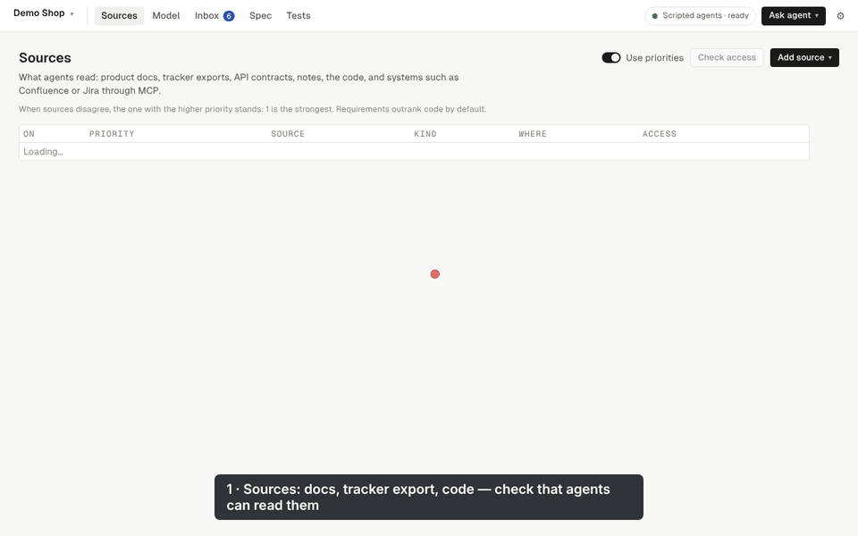

# Test Cartographer

An agentic testing environment: a local workspace where you and the coding agent you already use (Claude Code, Codex, GitHub Copilot or Cursor) explore a web application together, rebuild a model of how it behaves, and turn the confirmed model into Playwright tests. Test Cartographer is not an agent itself. It is to testing what an agentic development environment is to coding: you bring the agent, it brings the tools, the model and the loop.

Writing end-to-end tests usually starts with someone working out how the product actually behaves: which states an order goes through, who can cancel it and when, what must stay impossible. Test Cartographer gives your agent the tools to do that work with you. It clicks through each role's interface and reads your docs, code and backlog, proposes what it finds, and you decide what is a requirement. From the confirmed model the engine generates Playwright tests, including the negative ones: everything a role must *not* be able to do.

> **Status: early alpha.** It runs on Linux, Windows and macOS with Node.js 24+, and the file formats may still change. Issues and pull requests are welcome, see [CONTRIBUTING](CONTRIBUTING.md).

## Quick start

```bash
git clone https://github.com/MaksimKravchuk/test-cartographer.git
cd test-cartographer
pnpm install
pnpm exec playwright install chromium   # once
pnpm demo                               # demo shop on :4400 (the app under exploration)
```

In a second terminal:

```bash
pnpm start                              # builds the GUI, starts the engine on :4317 and opens it in your browser
```

There is no installer: you build and run it from source on Linux, Windows or macOS.

## Documentation

- **[Install and run](docs/install.md)**: requirements, ways to run it, platforms, connecting your agent (or a local model).
- **[Quickstart](docs/quickstart.md)**: the whole loop on the bundled demo shop in about 5 minutes, with or without an agent.
- **[Usage guide](docs/usage.md)**: the loop (sources, model, agent research, decisions, spec, tests), starting on your own product, the command line, and the project file formats.
- **[Vikunja case study](docs/case-studies/vikunja.md)**: the loop on an open-source to-do app, from five help pages to 217 Playwright tests and 9 findings in the product.
- **[Contributing](CONTRIBUTING.md)**: how the code is laid out and how to test it.

## The knowledge loop



1. **Sources**: docs, tracker exports, code folders, Confluence or Jira through MCP, each with a priority (requirements outrank code by default).
2. **Model**: subjects, objects, actions and rules, written by you or proposed by your agent.
3. **Research**: your agent reads the sources and clicks through the app, and proposes confirmations, gaps and contradictions with quotes.
4. **Decide**: you accept or strike out each proposal and settle each disagreement.
5. **Spec and tests**: the confirmed model becomes a specification and Playwright tests, including the negative ones.

## Layout

```
apps/desktop      GUI and the Electron shell
packages/engine   engine: local API, MCP clients, agents, test compiler and runner
packages/model    model schema, reachability, plan, coverage, proposals; no browser I/O
demo/shop         demo shop (buyer storefront + Marketplace) and its MCP server
workspace         the demo project: a plain folder that works well in git
```

## What's next

1. A public case: an undocumented app → specification → tests and the disagreements found.
2. Later: a recorded HAR session as a source, noticing when sources change, cleaning up test data by `runTag`, agent-authored changes to the action library reviewed by a person, pushing runs to Allure TestOps (scenario IDs and epic/feature/story labels are already on every compiled test).

## License

[Apache License 2.0](LICENSE). Contributions are accepted under the [Contributor License Agreement](CLA.md).

The agent runtimes are third-party SDKs installed as dependencies, each under its own terms, which this project's license doesn't cover: the Claude Agent SDK ([Anthropic Commercial Terms](https://www.anthropic.com/legal/commercial-terms)), the Cursor SDK ([Cursor Terms of Service](https://cursor.com/terms-of-service)), the GitHub Copilot SDK (MIT) and the Codex SDK (Apache-2.0). Using one also requires an account with that vendor, except Codex on your own model endpoint.
