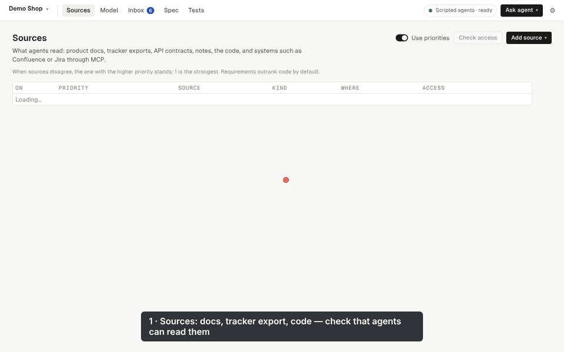

# Quickstart: the whole loop in 5 minutes

This walks the loop on the bundled demo shop: sources → model → your agent's review → disagreements → specification → Playwright tests. You don't need an agent to try it: without one, every agent step replays a recorded script from `workspace/agents/`, so you see exactly what an agent would do.



## 0. Install (2 minutes)

You need [Node.js 24+](https://nodejs.org) and [pnpm](https://pnpm.io/installation).

```bash
git clone https://github.com/MaksimKravchuk/test-cartographer.git
cd test-cartographer
pnpm install
pnpm exec playwright install chromium
```

Start the demo shop (the app under test) and Test Cartographer, each in its own terminal:

```bash
pnpm demo        # demo shop on http://localhost:4400
```

```bash
pnpm tc serve    # engine on :4317
```

```bash
pnpm ui          # the app on http://localhost:5173 — open it
```

The demo project opens on its own. It is the plain folder `workspace/`: everything you do below changes files there, so `git status` shows it and `git checkout workspace` undoes it.

## 1. Pick your agent

Test Cartographer is not an agent: it drives the coding agent you already use and gives it the tools (read sources, quote them, click through the app, propose changes). Open **Agents**:

- **With an agent.** Sign in once in a terminal (`claude auth login`, `codex login`, `gh auth login`, or **Sign in** on the Cursor card), pick it as the **Provider** and press **Save settings**. **Test run** checks it end to end. Runs use your own plan; nothing is billed per token here.
- **Without one.** Pick **None — scripted runs only** and **Save settings**. The steps below then replay the recorded runs.

## 2. Sources

Open **Sources**. The demo has three: a product overview (`product-overview.md`), a Jira-like export (`backlog.csv`) and the shop's code folder. Requirements have priority 1, code priority 2, so when they disagree the requirement stands by default.

Press **Check access**. Each source gets a ✓ with what an agent can read: lines of a file, files in a folder. A source behind MCP (Confluence, Jira) is checked with one real call.

## 3. Model and review

Open **Model**. The demo already has one: subjects (guest, buyer, seller, the shop's background jobs), objects (order, listing, line item), their actions and rules. **What to do next** lists what the model checks find without an agent: actions nobody described, rules no source backs.

Press **Review the model**. The agent reads each source against each element of the model, quotes what it finds (the **Log** at the bottom shows every call) and proposes:

- confirmations: the docs and the code say the same as the model;
- what's missing: a rule or an action the sources describe and the model doesn't;
- contradictions: the product overview says *"A buyer can cancel an order only until it has been paid"*, while `demo/shop/domain.ts` lets the buyer cancel a paid order.

Findings appear in place with a dashed border. Click **Cancel** in the buyer's row of the actions matrix to see that action's rules with their quotes, then decide each finding: **✓** true, it's a requirement; **≈** that's how it works, but not a requirement; **⏳** required but not built yet; **✕** strike out, agents won't propose it again.

## 4. Disagreements

Open **Disagreements**. Each card quotes both sides with a link to the exact lines, and marks the side that stands by priority. Settle the cancel one as **Bug in the product**: the requirement wins and the tests will check it. (**Requirements are outdated** would make the code the truth instead; **Not a problem** closes it.)

**By source** shows the same review as a table: every element against every source, ✓ confirms, ✕ contradicts.

## 5. Specification

Open **Specification**: the confirmed model as one Markdown document, with who performs each action, its rules and the quotes behind them, open questions and known defects. It is also written to `workspace/export/spec.md`.

## 6. Tests

Press **Run all tests** at the top. The engine generates Playwright tests from the model, about 300 for the demo, including the negative ones (everything a role must *not* be able to do), runs them against the shop and shows the results on **Overview** and per object. It takes a couple of minutes.

Three tests fail, on purpose: the demo shop has planted bugs. The buyer can still cancel a paid order and an accepted one (the disagreement from step 4), and the seller can archive an out-of-stock listing. Each failure is either a bug to report or a rule to revisit, which takes you back to step 3. That's the loop.

The same from the command line:

```bash
pnpm tc validate          # is the model consistent and testable
pnpm tc run               # compile and run the tests, report in workspace/runs/
pnpm tc coverage          # what is covered, per transition and variant
pnpm tc export md         # scenarios as Markdown
```

The generated tests are a plain Playwright project (`workspace/generated/`), so CI can run them without the app.

## Next: your own product

- **Projects → New project** creates an empty workspace anywhere on disk.
- On **Sources**, add your docs, tracker exports, a code folder, or Confluence/Jira through MCP, and press **Check access**.
- On **Model**, write what you know by hand, or press **Run first research** to have your agent propose subjects, objects, actions and rules from the sources, then **Review the model** as above.
- An explorer agent can also click through each role's interface: `pnpm tc explore <agent>`.

The [README](../README.md) describes the model, the agents and the test runtime in full.
