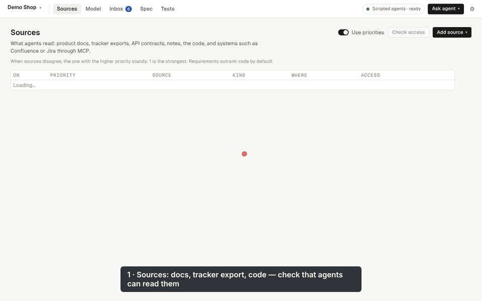

# Usage guide

How to work with Test Cartographer once it runs. Installing it and connecting your agent is in [install and run](install.md); a hands-on 5-minute tour of the demo shop is the [quickstart](quickstart.md).

- [The idea](#the-idea)
- [The loop](#the-loop): sources, model, research, decisions, spec, tests
- [Starting on your own product](#starting-on-your-own-product)
- [Command line](#command-line)
- [Reference](#reference): the project folder, the model, agents and proposals, backlog, tests

## The idea

Writing end-to-end tests starts with someone working out how the product actually behaves: which states an order goes through, who can cancel it and when, what must stay impossible. Test Cartographer keeps that knowledge as a **model** of the product, written by you and researched by agents, and generates Playwright tests from the part of it you confirmed.

Test Cartographer is not an agent. You bring the coding agent you already use (Claude Code, Codex, GitHub Copilot, Cursor, or a local model through Codex); Test Cartographer gives it the tools (read and quote the sources, click through the app, propose changes) and keeps the model, the decisions and the tests.

The agent never changes the model on its own. It **proposes**, with quotes and evidence, and a person decides. Nothing becomes a requirement, and nothing gets tested, until a person accepts it.

## The loop



It is a loop, not a wizard. A person and agents keep adding to the same model until it describes the system well enough to test it. You can enter it anywhere: write the model by hand, start with research, or ask for a review of what you already have.

### 1. Sources: what is known about the product

List everything an agent may read:

- **Documents**: product docs, tracker exports (epics, features, stories), API contracts, notes. Uploaded by file, drag-and-drop or pasted text.
- **Code folders**: the product's repository on your disk.
- **Systems behind MCP**: Confluence, Jira and the like, read through an MCP server's read tool.

Each source has a **priority**. By default requirements (1) outrank code (2): when they disagree, the requirement stands unless you decide otherwise. You can change the priorities, switch a source off, or turn priorities off for the project so every disagreement goes to you.

**Check access** proves each source can be read the way agents will read it, and shows what was found (lines of a file, files in a folder, one real call to an MCP tool), so a missing page or folder is noticed before a run, not during it.

### 2. Model: subjects, objects, actions, rules

The model describes the product in its own terms:

- **Subjects** are who acts: roles such as guest, buyer, seller, and system actors such as a scheduler or an integration.
- **Objects** are what they act on: an order, a listing, a line item. Objects have states, parameters and relations to each other (a line item is part of an order, an order refers to a listing).
- **Actions** are what a subject does to an object: place, pay, cancel, archive. Some change the state (an order goes from *paid* to *cancelled*), some don't (a read, an edit).
- **Rules** say in plain words when an action is allowed and what it must do: "a buyer can cancel an order only until it has been paid". A rule is useful even before it is formalized into states and conditions.

Each rule shows where it comes from: the **R**equirements, the **C**ode, the **A**pp, with quotes. Anything you write by hand is yours; anything an agent adds arrives as a proposal.

Everything not explicitly allowed is denied (the **closed world**). If the model says only a seller can archive a listing, the tests also check that a buyer and a guest can't.

### 3. Research: ask your agent

Three kinds of agent runs, each reading the sources you listed:

- **Research from scratch** proposes a first model: subjects, objects, actions, rules and the backlog, every item backed by an exact quote. An agent can't cite text that isn't in the source; the engine refuses it.
- **Review the model** checks what you have against every source and proposes confirmations, what's missing, and contradictions ("the overview says a buyer can't cancel a paid order; `domain.ts` lets them"), quoting both sides (`file#Lx-Ly` for code).
- **Explore the app** has the agent sign in as a role and click through that role's interface, recording snapshots and screenshots as evidence.

A run shows its progress and raw log while it works. Agents run in your coding agent's sign-in; nothing leaves your machine except what that agent sends to its own vendor.

### 4. Decide: accept or strike out

Every change an agent proposes is decided by a person, one item at a time:

| Decision | Means | Tested? |
|---|---|---|
| **Accept as requirement** | the product must do this | yes |
| **Observed only** | it works this way, but no source requires it | no, kept in the model |
| **Not built yet** | required, not in the product yet | not yet, and its absence isn't a bug |
| **Strike out** | wrong or irrelevant | no, and agents won't propose it again |

Everything waiting for you is in one queue, the **Inbox**: proposed changes, contradictions, gaps, questions and sources an agent couldn't read.

- A **contradiction** shows each side's quote, with the one that stands by priority marked. Settle it as **Bug in the product** (the requirement wins, tests will check it), **Requirements are outdated** (the code is the truth) or **Not a problem**.
- A **question** is answered yes, no, or in your own words.
- **Need more context** sends an agent back to the sources when you can't answer an item as written: it finds where the thing shows in the app or API and replaces the item with questions that ask one thing each.

The queue works from the keyboard (**B**, **U**, **N**, **M** for the decisions above, **J** / **K** to move).

Then go around again: add a source, edit the model, ask for another review. Each round leaves fewer open items.

### 5. Spec: the confirmed model as a document

The **Spec** is the confirmed model as one Markdown document: subjects, objects, every action with who performs it, its rules with their sources and how many tests check each, open questions and known defects. Save it as `export/spec.md` to share or review it like any document.

### 6. Tests: generated from the same model

From the confirmed model the engine generates Playwright tests:

- one per confirmed transition and permitted action, for each role allowed to do it and each variant (a physical and a digital order);
- one **deny** test per role, action and state the model doesn't allow: everything a role must *not* be able to do;
- **journeys**: paths written by people and checked end to end, such as an order from placement to delivery;
- **business rules** tied to an action, such as "an order can be created only for a published listing".

Run them from the GUI (all, one object, one scenario) or with `pnpm tc run`. A failing test is either a bug to report or a rule to revisit, which takes you back to step 3. The generated tests are a plain Playwright project (`generated/`), so CI can run them without the GUI.

## Starting on your own product

1. Create a project from the project menu: an empty folder with `cartographer.yaml`, anywhere on disk, with a guest and a signed-in role to start from.
2. Add your sources and press **Check access**.
3. Write what you know by hand, or run **Research from scratch**; then **Review the model**.
4. Work through the Inbox.
5. Tell the engine how to reach the app under test: an MCP server for setup and reading state (`cartographer.yaml → mcp`), sign-in for each role, and an action library (`actions/index.ts`) for what each role does in the UI. See [Reference](#reference).
6. Run the tests, read the failures, go around again.

The [Vikunja case study](case-studies/vikunja.md) runs this on an open-source to-do app: from five help pages to 217 Playwright tests and 9 findings in the product.

## Command line

Everything the loop needs also runs without the GUI: `pnpm tc <command> [--ws <project folder>]`.

| Command | What it does |
|---|---|
| `validate` | reference integrity, tool allowlist, action library coverage, state reachability |
| `plan [entity]` | coverage plan: one scenario per confirmed transition and permit, plus one per denied cell of the access matrix, for each role and variant |
| `compile` | generates `generated/*.spec.ts` |
| `run [--grep text]` | compiles, runs, and writes a report to `runs/` |
| `coverage [entity]` | transition × variant matrix from the latest results |
| `export md` | scenarios to `export/*.md` |
| `explore <agent> [--scripted]` | an agent explores its role's interface and writes a proposal |
| `onboard [agent] [--scripted]` | research from scratch: reads the sources and proposes roles, entities, the model and the backlog |
| `backlog` | epics → features → stories, with totals and unmapped stories |
| `eval <reference>` | compares the model (with every proposal as if accepted) to a reference: recall, precision, extras |
| `runtimes [test <provider>]` | sign-in state of the agent runtimes; a short end-to-end run |
| `serve [--port 4317] [--open]` | the engine API and the web GUI |

`--scripted` replays the agent's recorded script from `agents/*.yaml`: deterministic, no model needed.

## Reference

The model lives in plain files; the GUI is a view over them. This section describes those files.

### The project folder

```
cartographer.yaml     roles, interfaces, MCP servers and their allowed tools, agent runtime
sources.yaml          knowledge sources (+ sources/ for uploaded files)
entities/<id>.yaml    one object each: variants, states, actions, transitions, permits, rules, journeys
backlog.yaml          epics, features, stories
agents/*.yaml         agent definitions and scripted runs
actions/index.ts      the action library: what each role does in the UI
proposals/*.yaml      agents' proposals and the decisions on them
evidence/             what agents saw: snapshots, screenshots, read results
generated/            generated Playwright tests
runs/                 run reports
export/               spec.md and scenario Markdown
```

The engine watches the folder and tells the GUI when a file changes, so you can edit YAML by hand, use git, and review changes as diffs. Removing an entity or a source moves it to `entities/.trash` or `sources/.trash`. A project anywhere on disk gets a link to the engine in its own `node_modules`, so its generated tests and action library resolve `@tc/engine`.

### Statuses and provenance

Every element of the model has a status:

- `confirmed`: a requirement; only these go into the test plan;
- `observed`: this is how it works, but it's not a requirement; kept, not planned;
- `planned`: required, not built yet; not tested, and code that lacks it isn't a bug;
- `proposed`: waiting for a person;
- `rejected`: kept so agents don't propose it again.

`provenance` records who added it (a person or an agent), the proposal, the knowledge sources that back it, and evidence (screenshots, page snapshots, read results, kept in `evidence/`).

### Subjects

`cartographer.yaml → roles` gives each role a `kind`: `human` acts through an interface; `system` (a background job, a scheduler, an integration) has no interface and acts only through actions with an `invoke` tool.

**Roles sign in** with an action from the library before they act (`role.login`). Credentials can use `{{env.NAME}}` or a role's own data, `{{roles.<id>.<field>}}`. A role without a login acts as a guest.

**Data on subjects and objects.** A role or an entity can carry `fields`: named values for agents and tests, such as a login, a test card number, a promo code.

```yaml
roles:
  - id: seller
    fields:
      - id: login
        value: seller
      - id: password
        value: "{{env.SELLER_PASSWORD}}"   # or a literal, for a demo account
        secret: true
        note: the marketplace account   # told to agents as is
    login:
      action: auth.login
      args: { username: "{{roles.seller.login}}", password: "{{roles.seller.password}}" }
```

- Agents get every subject's and object's fields in their instructions. An explorer can type a field reference such as `{{roles.seller.password}}` into the app; the engine substitutes the value.
- **A secret never reaches the model**: it sees only the reference, and a secret value that comes back in a page snapshot, a read result or an error is replaced with the reference before the agent gets it.
- Tests template `{{roles.<id>.<field>}}` / `{{entities.<id>.<field>}}` in login args; actions in the library get every value as `ctx.data`.
- Values are stored as plain text; for a real account use `{{env.NAME}}`.

### Objects (entities)

`entities/<id>.yaml` holds variants, states, actions, transitions and permits.

- **Actions** are verbs on the entity with no notion of state or permission: `run` is an entry of the action library a person performs through the UI; `invoke` is an MCP trigger tool a test uses to make the system perform it; `trigger` is prose describing what makes the product do it on its own (a schedule, a timeout), documentation only.
- **Transitions** tie an action to who may perform it and what it does: `action`, `by` (roles), `from → to`, effects. **Creating** an instance is a transition from `@new`: its action creates it through the UI and returns the new key.
- **Permits** are the same for an action that leaves the state as it is (a read, an update): `by` may perform `action` over a set of `states` (all, if none are given).
- **Closed world.** For human roles, anything not allowed by a confirmed transition or permit is denied. The engine derives the matrix role × action × state and plans one deny scenario per denied cell; a cell only an unconfirmed element allows is left undecided.

**Relations** link entities:

```yaml
relations: [{ id: listing, entity: listing, field: listingId, requires: published, variants: { standard: physical } }]
```

on the order means an order refers to a listing through `listingId`, is created for a published listing, and a standard order goes with a physical listing. `kind` is `reference` (the default: this entity holds the related one's key) or `part-of` (this entity lives inside the related one, like a line item inside an order; at most one parent). From that:

- **Setup dependencies.** Before preparing an order, the engine prepares the related listing in the required state and passes its key to setup tools as `{{rel.listing}}` and to actions as `ctx.related.listing`.
- **Effects on related instances.** `{ relation: listing, field: stock, delta: -1 }` on a transition reads the listing before the act and checks the change after it; `equals` checks an exact value.
- **Rules on a related state.** `{ kind: entity-state, relation: listing, states: [published] }` yields one negative scenario per other reachable state of the listing.

**State probe.** `entity.reader` says how to read an instance's actual state through an allowed MCP tool; `state.match` lists the fields that must match. It runs after every setup and every transition. Without a reader, the entity's scenarios plan as `blocked` and validation warns.

**Setup.** A state is reached by a setup tool (`setup: tool`), an explicit path of transitions (`setup: path`), or, with no recipe, the shortest path through confirmed transitions from a state a setup tool can prepare.

**Allowlist.** The engine calls only tools listed in `cartographer.yaml → mcp.*.allow`, with setup, read and trigger calls each kept to their own list.

### Scenarios

An entity's scenarios come in four kinds:

- **generated** from the model: one per confirmed transition and one per permit, for each role that may perform it and each variant;
- **deny**: one per denied cell of the access matrix;
- **journeys** written by people: a path of transitions checked end to end;
- **business rules** tied to a transition. A `roles` or `authenticated` condition tags the deny scenarios it explains instead of producing its own; an `entity-state` condition gets its own scenario per other reachable state of the related instance.

Every scenario has a stable ID, `entity/transition/variant`, which flows through the plan, the test, the run report and the Markdown.

### Sources

`sources.yaml` lists the sources: `id`, `title`, `kind` (`doc`, `backlog`, `contract`, `note`, `code` with a `path`, or `mcp` with a `read` tool and its args), `priority` (1 is the strongest), `enabled`. `usePriority: false` at the top turns priorities off.

### Agents and proposals

How agents work (planning a run, reading requirements and code, exploring an app, citing evidence, asking questions) is written as [Agent Skills](../packages/engine/skills/README.md): plain `SKILL.md` folders the engine hands to whichever runtime runs the agent. An agent can override the project's runtime with its own `runtime:`.

An agent's result is `proposals/*.yaml`: a patch to the model (`add` / `update` / `remove`) plus findings (gap, contradiction, question) and evidence.

- A proposal patches one entity or, with no `entity`, the project itself: roles, interfaces, new entities, backlog items. A `role` / `interface` / `entity` op has no status of its own: accept applies it, strike out skips it.
- A change to an entity that isn't in the model yet offers to add the entity too, from the agent's own proposal of it when there is one.
- Research from scratch writes one project-level proposal plus one per entity; an entity's proposal can be decided once its entity exists.
- A proposal is made against a model revision. If the model changed since, only operations that actually broke count as conflicts.

### Backlog: epics, features, stories

`backlog.yaml` is a view over the model, not a second one: behavior still lives in the entities.

- A **feature** slices the model by action: `feature.actions` lists `<entity>.<action>` refs, across entities.
- A **story** cites what it specifies in `covers`, as `<kind>:<entity>.<id>` with kind `action`, `transition`, `permit`, `rule` or `journey`. A story with no ref that resolves is **unmapped**: a requirement not in the model yet.
- **Coverage** rolls up from the entities' plans to features and epics, counting passed, failed, blocked and not-run.

Compiled tests carry `@epic:<id>`, `@feature:<id>`, `@story:<id>` tags and annotations, so a test management tool can group results the same way.

### Tests

A generated spec holds only scenario data. Execution (setup through MCP, probes, actions, deny checks) lives in `@tc/engine/runtime`; what each role does in the UI lives in the project's `actions/index.ts`. The result is a regular Playwright project, so `pnpm tc run` works in CI without the GUI.

### The demo

`workspace/` is the demo project for the demo shop (`demo/shop`). Its sources in `demo/shop/knowledge/` are written to disagree with the running app on purpose: the overview says a buyer can cancel only until payment, which the shop doesn't enforce; it lets a seller archive a listing in any state; and it describes buyer reviews, which the shop has no UI or API for, so that entity has no reader and its scenarios plan as `blocked`. `workspace/agents/review.yaml` and `onboarding.yaml` are scripted runs over these sources.
